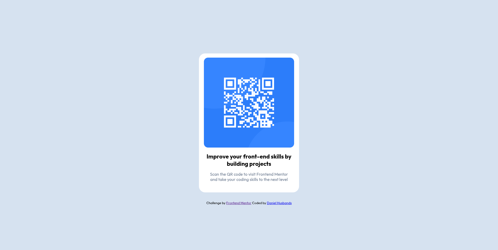
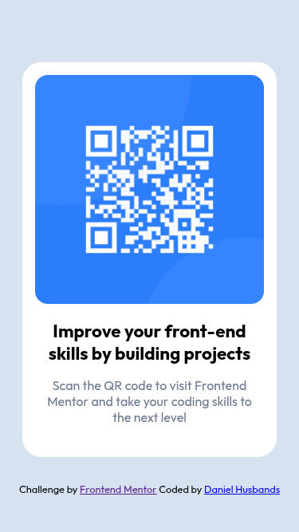

# Frontend Mentor - Order summary card solution by Daniel Husbands

This is my solution to the QR-Code-Components challenge. 

## Table of contents

- [Overview](#overview)
  - [The challenge](#the-challenge)
  - [Screenshot](#screenshot)
  - [Links](#links)
- [My process](#my-process)
  - [Built with](#built-with)
  - [What I learned](#what-i-learned)
  - [Continued development](#continued-development)
  - [Useful resources](#useful-resources)
- [Author](#author)

## Overview

### The challenge

I think I have acheived the main challenge, I have got it looking as close as I can by eye. I don't have access to figma so all sizes, margins etc are done by eye and what looks best / closest to the design.

### Screenshot

### Links

- Solution URL: (https://www.frontendmentor.io/solutions/qr-code-component-zjJA7b_R69)
- Live Site URL:(https://itstoko.github.io/FMC/QRCode/index.html)

## My process

### Built with

- Semantic HTML5 markup
- CSS custom properties
- Flexbox

### What I learned

Flexbox and importing fonts. Its funny how easy it is to forget things after a long break.

### Continued development

This is my first challenge after a 4 year break from coding. This was a good start for me as it showed me what I needed to focus on more for the upcoming challeneges. Easy enough for me to not loose interest and due to lack of knowledge hard enough to make me look for solutions.

### Useful resources

- [MDN](https://developer.mozilla.org/en-US/) - 

## Author

- Website - [Daniel Husbands](https://itstoko.github.io/)
- Frontend Mentor - [@itsToko](https://www.frontendmentor.io/profile/itsToko)
