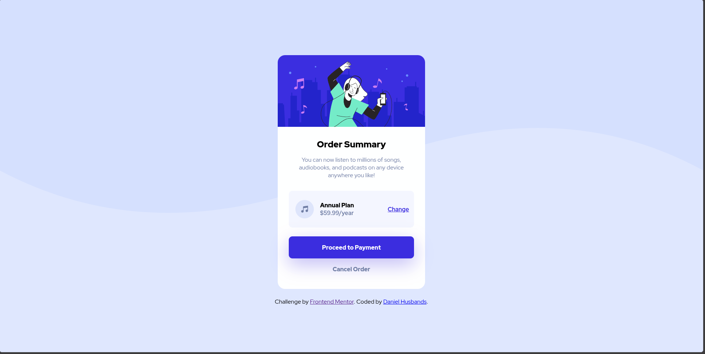

# Frontend Mentor - Order summary card solution by Daniel Husbands

This is a solution to the [Order summary card challenge on Frontend Mentor](https://www.frontendmentor.io/challenges/order-summary-component-QlPmajDUj). Frontend Mentor challenges help you improve your coding skills by building realistic projects. 

## Table of contents

- [Overview](#overview)
  - [The challenge](#the-challenge)
  - [Screenshot](#screenshot)
  - [Links](#links)
- [My process](#my-process)
  - [Built with](#built-with)
  - [What I learned](#what-i-learned)
  - [Continued development](#continued-development)
  - [Useful resources](#useful-resources)
  - [AI Collaboration](#ai-collaboration)
- [Author](#author)

## Overview

### The challenge

I feel as though I have achieved the challenge to the best of my ability. The summary card I have made looks very close to the design. I dont have the pelasure of Figma just yet so gaps between items are done by eye currently, the same with some of the colours.

The active states of all the buttons also work while tabbing through and touch.

### Screenshot

### Links

- Solution URL: [Add solution URL here](https://your-solution-url.com)
- Live Site URL: [Add live site URL here](https://itstoko.github.io/FMC/order-summary-component-main/index.html)

## My process

I started with opening the desktop-design image, from there I noted down what tags I needed and how I could format them. Once that was done I started getting some of the basic styling done; some background color, adding in background with its radiused corners and adding the font-weights. Adding flex where it was needed helped things to start looking the part. Thats when I realised I needed to use grid to achieve the design with the Annual Plan section of the card. Then moved onto with the active states, testing they all work with mouse hover, tabbing and touch. And finished off with the slight box-shadow on the payment button.

### Built with

- Semantic HTML5 markup
- CSS custom properties
- Flexbox
- CSS Grid

### What I learned

On this project I re-learned how to set a background image and had the image change for different screen sizes using media queries.

### Continued development

So I am still getting back into the swing of html and CSS after a few years of not using it at all. So every project is helping me develop my skills, and each new challenge always has something new for me to learn.

### Useful resources

- [MDN](https://developer.mozilla.org/en-US/) - Always coming here to find how certain elements work and where I can use them. I used this site to remind myself how to use the css background image property  and for the box-shadow property.

### AI Collaboration

No AI used.

## Author

- Website - [Daniel Husbands](https://itstoko.github.io/)
- Frontend Mentor - [@yourusername](https://www.frontendmentor.io/profile/itsToko)
